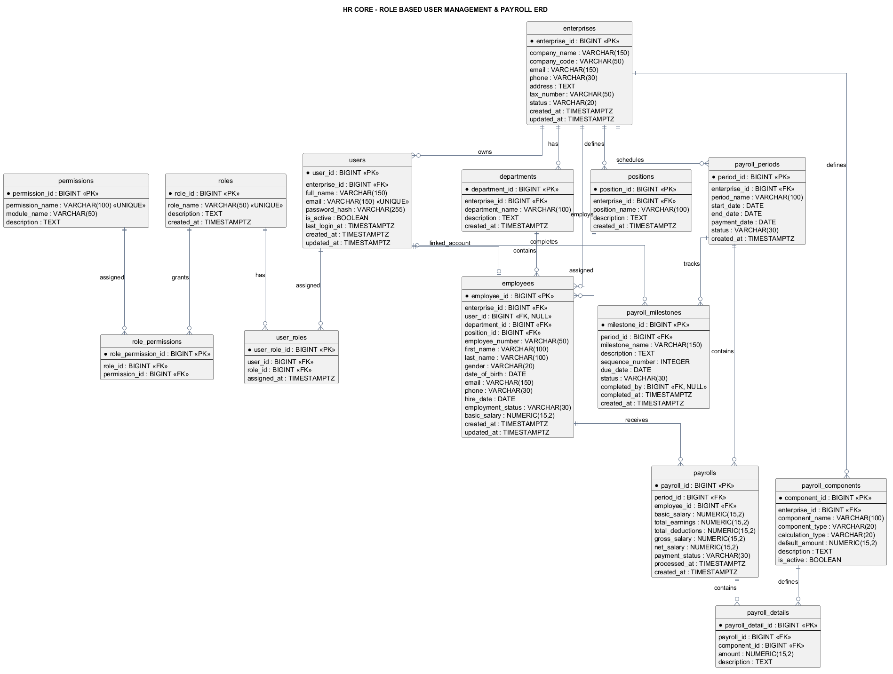

# HR-Core & Payroll Management System

Database design untuk sistem Enterprise Management, Human Resource (HR), dan Payroll menggunakan PostgreSQL. Sistem menerapkan konsep relational database dan Role-Based Access Control (RBAC) untuk mengatur hak akses pengguna.

## Entity Relationship Diagram (ERD)



ERD menggambarkan struktur entitas, atribut, Primary Key (PK), Foreign Key (FK), dan hubungan antar tabel.

Diagram dibuat menggunakan PlantUML.

**File:** `docs/diagrams/db_hr_core.puml`

Untuk melihat diagram, buka file `.puml` menggunakan ekstensi PlantUML di Visual Studio Code.

## DDL

```sql

CREATE DATABASE db_hr_core;


CREATE TABLE enterprises (
    enterprise_id BIGINT GENERATED ALWAYS AS IDENTITY PRIMARY KEY,
    company_name VARCHAR(150) NOT NULL,
    company_code VARCHAR(50) NOT NULL UNIQUE,
    email VARCHAR(150) NOT NULL,
    phone VARCHAR(30),
    address TEXT,
    tax_number VARCHAR(50),
    status VARCHAR(20) NOT NULL DEFAULT 'active'
        CHECK (status IN ('active', 'inactive')),
    created_at TIMESTAMPTZ DEFAULT CURRENT_TIMESTAMP,
    updated_at TIMESTAMPTZ DEFAULT CURRENT_TIMESTAMP
);


CREATE TABLE users (
    user_id BIGINT GENERATED ALWAYS AS IDENTITY PRIMARY KEY,
    enterprise_id BIGINT NOT NULL,
    full_name VARCHAR(150) NOT NULL,
    email VARCHAR(150) NOT NULL UNIQUE,
    password_hash VARCHAR(255) NOT NULL,
    is_active BOOLEAN DEFAULT TRUE,
    last_login_at TIMESTAMPTZ,
    created_at TIMESTAMPTZ DEFAULT CURRENT_TIMESTAMP,
    updated_at TIMESTAMPTZ DEFAULT CURRENT_TIMESTAMP,

    CONSTRAINT fk_users_enterprise
        FOREIGN KEY (enterprise_id)
        REFERENCES enterprises(enterprise_id)
        ON DELETE CASCADE
);


CREATE TABLE roles (
    role_id BIGINT GENERATED ALWAYS AS IDENTITY PRIMARY KEY,
    role_name VARCHAR(50) NOT NULL UNIQUE,
    description TEXT,
    created_at TIMESTAMPTZ DEFAULT CURRENT_TIMESTAMP
);


CREATE TABLE permissions (
    permission_id BIGINT GENERATED ALWAYS AS IDENTITY PRIMARY KEY,
    permission_name VARCHAR(100) NOT NULL UNIQUE,
    module_name VARCHAR(50) NOT NULL,
    description TEXT
);


CREATE TABLE user_roles (
    user_role_id BIGINT GENERATED ALWAYS AS IDENTITY PRIMARY KEY,
    user_id BIGINT NOT NULL,
    role_id BIGINT NOT NULL,
    assigned_at TIMESTAMPTZ DEFAULT CURRENT_TIMESTAMP,

    CONSTRAINT fk_user_roles_user
        FOREIGN KEY (user_id)
        REFERENCES users(user_id)
        ON DELETE CASCADE,

    CONSTRAINT fk_user_roles_role
        FOREIGN KEY (role_id)
        REFERENCES roles(role_id)
        ON DELETE CASCADE,

    CONSTRAINT uq_user_role
        UNIQUE (user_id, role_id)
);


CREATE TABLE role_permissions (
    role_permission_id BIGINT GENERATED ALWAYS AS IDENTITY PRIMARY KEY,
    role_id BIGINT NOT NULL,
    permission_id BIGINT NOT NULL,

    CONSTRAINT fk_role_permissions_role
        FOREIGN KEY (role_id)
        REFERENCES roles(role_id)
        ON DELETE CASCADE,

    CONSTRAINT fk_role_permissions_permission
        FOREIGN KEY (permission_id)
        REFERENCES permissions(permission_id)
        ON DELETE CASCADE,

    CONSTRAINT uq_role_permission
        UNIQUE (role_id, permission_id)
);


CREATE TABLE departments (
    department_id BIGINT GENERATED ALWAYS AS IDENTITY PRIMARY KEY,
    enterprise_id BIGINT NOT NULL,
    department_name VARCHAR(100) NOT NULL,
    description TEXT,
    created_at TIMESTAMPTZ DEFAULT CURRENT_TIMESTAMP,

    CONSTRAINT fk_departments_enterprise
        FOREIGN KEY (enterprise_id)
        REFERENCES enterprises(enterprise_id)
        ON DELETE CASCADE,

    CONSTRAINT uq_department
        UNIQUE (enterprise_id, department_name)
);


CREATE TABLE positions (
    position_id BIGINT GENERATED ALWAYS AS IDENTITY PRIMARY KEY,
    enterprise_id BIGINT NOT NULL,
    position_name VARCHAR(100) NOT NULL,
    description TEXT,
    created_at TIMESTAMPTZ DEFAULT CURRENT_TIMESTAMP,

    CONSTRAINT fk_positions_enterprise
        FOREIGN KEY (enterprise_id)
        REFERENCES enterprises(enterprise_id)
        ON DELETE CASCADE,

    CONSTRAINT uq_position
        UNIQUE (enterprise_id, position_name)
);


CREATE TABLE employees (
    employee_id BIGINT GENERATED ALWAYS AS IDENTITY PRIMARY KEY,
    enterprise_id BIGINT NOT NULL,
    user_id BIGINT UNIQUE,
    department_id BIGINT,
    position_id BIGINT,
    employee_number VARCHAR(50) NOT NULL,
    first_name VARCHAR(100) NOT NULL,
    last_name VARCHAR(100),
    gender VARCHAR(20),
    date_of_birth DATE,
    email VARCHAR(150),
    phone VARCHAR(30),
    hire_date DATE,
    employment_status VARCHAR(30) DEFAULT 'active',
    basic_salary NUMERIC(15,2) NOT NULL DEFAULT 0,
    created_at TIMESTAMPTZ DEFAULT CURRENT_TIMESTAMP,
    updated_at TIMESTAMPTZ DEFAULT CURRENT_TIMESTAMP,

    CONSTRAINT fk_employees_enterprise
        FOREIGN KEY (enterprise_id)
        REFERENCES enterprises(enterprise_id)
        ON DELETE CASCADE,

    CONSTRAINT fk_employees_user
        FOREIGN KEY (user_id)
        REFERENCES users(user_id)
        ON DELETE SET NULL,

    CONSTRAINT fk_employees_department
        FOREIGN KEY (department_id)
        REFERENCES departments(department_id)
        ON DELETE SET NULL,

    CONSTRAINT fk_employees_position
        FOREIGN KEY (position_id)
        REFERENCES positions(position_id)
        ON DELETE SET NULL,

    CONSTRAINT uq_employee_number
        UNIQUE (enterprise_id, employee_number),

    CONSTRAINT chk_employee_salary
        CHECK (basic_salary >= 0),

    CONSTRAINT chk_employee_status
        CHECK (employment_status IN ('active', 'inactive', 'terminated')),

    CONSTRAINT chk_employee_gender
        CHECK (gender IS NULL OR gender IN ('male', 'female', 'other'))
);


CREATE TABLE payroll_periods (
    period_id BIGINT GENERATED ALWAYS AS IDENTITY PRIMARY KEY,
    enterprise_id BIGINT NOT NULL,
    period_name VARCHAR(100) NOT NULL,
    start_date DATE NOT NULL,
    end_date DATE NOT NULL,
    payment_date DATE,
    status VARCHAR(30) DEFAULT 'draft',
    created_at TIMESTAMPTZ DEFAULT CURRENT_TIMESTAMP,

    CONSTRAINT fk_payroll_periods_enterprise
        FOREIGN KEY (enterprise_id)
        REFERENCES enterprises(enterprise_id)
        ON DELETE CASCADE,

    CONSTRAINT uq_payroll_period
        UNIQUE (enterprise_id, start_date, end_date),

    CONSTRAINT chk_payroll_period_dates
        CHECK (end_date >= start_date),

    CONSTRAINT chk_payroll_period_status
        CHECK (status IN ('draft', 'processing', 'approved', 'paid', 'cancelled'))
);


CREATE TABLE payrolls (
    payroll_id BIGINT GENERATED ALWAYS AS IDENTITY PRIMARY KEY,
    period_id BIGINT NOT NULL,
    employee_id BIGINT NOT NULL,
    basic_salary NUMERIC(15,2) NOT NULL DEFAULT 0,
    total_earnings NUMERIC(15,2) NOT NULL DEFAULT 0,
    total_deductions NUMERIC(15,2) NOT NULL DEFAULT 0,
    gross_salary NUMERIC(15,2) NOT NULL DEFAULT 0,
    net_salary NUMERIC(15,2) NOT NULL DEFAULT 0,
    payment_status VARCHAR(30) DEFAULT 'pending',
    processed_at TIMESTAMPTZ,
    created_at TIMESTAMPTZ DEFAULT CURRENT_TIMESTAMP,

    CONSTRAINT fk_payrolls_period
        FOREIGN KEY (period_id)
        REFERENCES payroll_periods(period_id)
        ON DELETE RESTRICT,

    CONSTRAINT fk_payrolls_employee
        FOREIGN KEY (employee_id)
        REFERENCES employees(employee_id)
        ON DELETE RESTRICT,

    CONSTRAINT uq_employee_payroll_period
        UNIQUE (period_id, employee_id),

    CONSTRAINT chk_payroll_amounts
        CHECK (
            basic_salary >= 0
            AND total_earnings >= 0
            AND total_deductions >= 0
            AND gross_salary >= 0
            AND net_salary >= 0
        ),

    CONSTRAINT chk_payment_status
        CHECK (payment_status IN ('pending', 'processing', 'paid', 'failed'))
);


CREATE TABLE payroll_components (
    component_id BIGINT GENERATED ALWAYS AS IDENTITY PRIMARY KEY,
    enterprise_id BIGINT NOT NULL,
    component_name VARCHAR(100) NOT NULL,
    component_type VARCHAR(20) NOT NULL,
    calculation_type VARCHAR(20) DEFAULT 'fixed',
    default_amount NUMERIC(15,2) DEFAULT 0,
    description TEXT,
    is_active BOOLEAN DEFAULT TRUE,

    CONSTRAINT fk_payroll_components_enterprise
        FOREIGN KEY (enterprise_id)
        REFERENCES enterprises(enterprise_id)
        ON DELETE CASCADE,

    CONSTRAINT chk_component_type
        CHECK (component_type IN ('earning', 'deduction')),

    CONSTRAINT chk_calculation_type
        CHECK (calculation_type IN ('fixed', 'percentage')),

    CONSTRAINT chk_component_amount
        CHECK (default_amount >= 0),

    CONSTRAINT uq_payroll_component
        UNIQUE (enterprise_id, component_name)
);


CREATE TABLE payroll_details (
    payroll_detail_id BIGINT GENERATED ALWAYS AS IDENTITY PRIMARY KEY,
    payroll_id BIGINT NOT NULL,
    component_id BIGINT NOT NULL,
    amount NUMERIC(15,2) NOT NULL DEFAULT 0,
    description TEXT,

    CONSTRAINT fk_payroll_details_payroll
        FOREIGN KEY (payroll_id)
        REFERENCES payrolls(payroll_id)
        ON DELETE CASCADE,

    CONSTRAINT fk_payroll_details_component
        FOREIGN KEY (component_id)
        REFERENCES payroll_components(component_id)
        ON DELETE RESTRICT,

    CONSTRAINT uq_payroll_detail_component
        UNIQUE (payroll_id, component_id),

    CONSTRAINT chk_payroll_detail_amount
        CHECK (amount >= 0)
);


CREATE TABLE payroll_milestones (
    milestone_id BIGINT GENERATED ALWAYS AS IDENTITY PRIMARY KEY,
    period_id BIGINT NOT NULL,
    milestone_name VARCHAR(150) NOT NULL,
    description TEXT,
    sequence_number INTEGER NOT NULL,
    due_date DATE,
    status VARCHAR(30) DEFAULT 'pending',
    completed_by BIGINT,
    completed_at TIMESTAMPTZ,
    created_at TIMESTAMPTZ DEFAULT CURRENT_TIMESTAMP,

    CONSTRAINT fk_milestones_period
        FOREIGN KEY (period_id)
        REFERENCES payroll_periods(period_id)
        ON DELETE CASCADE,

    CONSTRAINT fk_milestones_user
        FOREIGN KEY (completed_by)
        REFERENCES users(user_id)
        ON DELETE SET NULL,

    CONSTRAINT chk_milestone_status
        CHECK (status IN ('pending', 'in_progress', 'completed', 'delayed')),

    CONSTRAINT chk_milestone_sequence
        CHECK (sequence_number > 0),

    CONSTRAINT uq_milestone_sequence
        UNIQUE (period_id, sequence_number)
);
```

## DML

```sql
INSERT INTO departments (
    department_id,
    enterprise_id,
    department_name,
    description
)
OVERRIDING SYSTEM VALUE
VALUES
(1, 1, 'Human Resources', 'Mengelola sumber daya manusia'),
(2, 1, 'Finance', 'Mengelola keuangan perusahaan'),
(3, 1, 'Information Technology', 'Mengelola teknologi informasi');


INSERT INTO positions (
    position_id,
    enterprise_id,
    position_name,
    description
)
OVERRIDING SYSTEM VALUE
VALUES
(1, 1, 'Staff', 'Pegawai operasional'),
(2, 1, 'Supervisor', 'Mengawasi pekerjaan tim'),
(3, 1, 'Manager', 'Mengelola departemen'),
(4, 1, 'Analyst', 'Melakukan analisis pekerjaan'),
(5, 1, 'Director', 'Memimpin dan mengarahkan organisasi');


INSERT INTO employees (
    enterprise_id,
    user_id,
    department_id,
    position_id,
    employee_number,
    first_name,
    last_name,
    gender,
    date_of_birth,
    email,
    phone,
    hire_date,
    employment_status,
    basic_salary
)
VALUES
(1, NULL, 1, 1, 'EMP-001', 'Andi', 'Pratama', 'male', '1995-05-12', 'andi@company.com', '081234567801', '2022-01-10', 'active', 8500000),
(1, NULL, 1, 2, 'EMP-002', 'Siti', 'Aminah', 'female', '1997-08-20', 'siti@company.com', '081234567802', '2022-03-15', 'active', 7500000),
(1, NULL, 2, 3, 'EMP-003', 'Budi', 'Santoso', 'male', '1993-11-05', 'budi@company.com', '081234567803', '2021-06-01', 'active', 9500000),
(1, NULL, 2, 4, 'EMP-004', 'Dewi', 'Lestari', 'female', '1998-02-14', 'dewi@company.com', '081234567804', '2023-01-02', 'active', 6500000),
(1, NULL, 3, 5, 'EMP-005', 'Rizky', 'Firmansyah', 'male', '1996-07-25', 'rizky@company.com', '081234567805', '2023-05-10', 'active', 7000000),
(1, NULL, 1, 3, 'EMP-006', 'Rina', 'Anggraini', 'female', '1994-03-18', 'rina@company.com', '081234567806', '2021-08-12', 'active', 9000000),
(1, NULL, 2, 2, 'EMP-007', 'Dimas', 'Saputra', 'male', '1992-09-22', 'dimas@company.com', '081234567807', '2020-04-20', 'active', 10500000),
(1, NULL, 3, 1, 'EMP-008', 'Maya', 'Putri', 'female', '1999-01-30', 'maya@company.com', '081234567808', '2023-07-03', 'active', 6000000),
(1, NULL, 1, 4, 'EMP-009', 'Fajar', 'Nugroho', 'male', '1991-06-15', 'fajar@company.com', '081234567809', '2019-02-11', 'active', 11000000),
(1, NULL, 2, 5, 'EMP-010', 'Nadia', 'Permata', 'female', '1996-12-08', 'nadia@company.com', '081234567810', '2022-09-19', 'active', 7200000),
(1, NULL, 3, 2, 'EMP-011', 'Agus', 'Setiawan', 'male', '1990-04-25', 'agus@company.com', '081234567811', '2018-11-05', 'active', 12000000),
(1, NULL, 1, 5, 'EMP-012', 'Intan', 'Sari', 'female', '1998-10-17', 'intan@company.com', '081234567812', '2023-03-13', 'active', 6800000),
(1, NULL, 2, 1, 'EMP-013', 'Arif', 'Rahman', 'male', '1994-07-09', 'arif@company.com', '081234567813', '2021-12-01', 'active', 8800000),
(1, NULL, 3, 3, 'EMP-014', 'Lina', 'Marlina', 'female', '1995-02-27', 'lina@company.com', '081234567814', '2022-05-16', 'active', 8200000),
(1, NULL, 1, 2, 'EMP-015', 'Yoga', 'Prasetyo', 'male', '1997-11-19', 'yoga@company.com', '081234567815', '2023-08-21', 'active', 6500000),
(1, NULL, 2, 4, 'EMP-016', 'Fitri', 'Handayani', 'female', '1993-08-04', 'fitri@company.com', '081234567816', '2020-06-15', 'active', 9800000),
(1, NULL, 3, 4, 'EMP-017', 'Rudi', 'Hartono', 'male', '1989-12-11', 'rudi@company.com', '081234567817', '2017-09-04', 'active', 13500000),
(1, NULL, 1, 1, 'EMP-018', 'Ayu', 'Wulandari', 'female', '2000-05-23', 'ayu@company.com', '081234567818', '2024-01-08', 'active', 5500000),
(1, NULL, 2, 3, 'EMP-019', 'Hendra', 'Wijaya', 'male', '1992-03-07', 'hendra@company.com', '081234567819', '2019-10-14', 'active', 11500000),
(1, NULL, 3, 5, 'EMP-020', 'Vina', 'Oktaviani', 'female', '1997-06-29', 'vina@company.com', '081234567820', '2023-11-06', 'active', 7000000);


SELECT
    e.employee_id,
    e.employee_number,
    e.first_name,
    e.last_name,
    d.department_name,
    p.position_name,
    e.email,
    e.basic_salary,
    e.employment_status
FROM employees e
LEFT JOIN departments d
    ON e.department_id = d.department_id
LEFT JOIN positions p
    ON e.position_id = p.position_id
ORDER BY e.employee_id;

```
